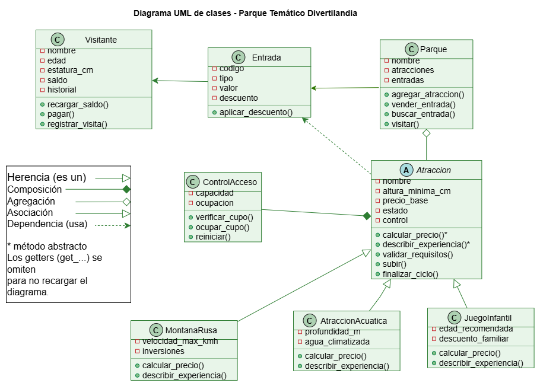

# Diagrama UML de clases

Imagen del diagrama: [diagrama_uml.png](diagrama_uml.png)

## Excepciones personalizadas
Todas heredan de `ParqueError`.

| Excepción | La lanza | Cuándo |
|---|---|---|
| `AlturaInsuficienteError` | `Atraccion.validar_requisitos()` | El visitante mide menos que el mínimo |
| `AtraccionEnMantenimientoError` | `Atraccion.validar_requisitos()` | La atracción está fuera de servicio |
| `AtraccionLlenaError` | `ControlAcceso.verificar_cupo()` | No quedan cupos |
| `SaldoInsuficienteError` | `Visitante.pagar()` | El saldo no alcanza |
| `SinEntradaError` | `Parque.visitar()` | El visitante no compró entrada |